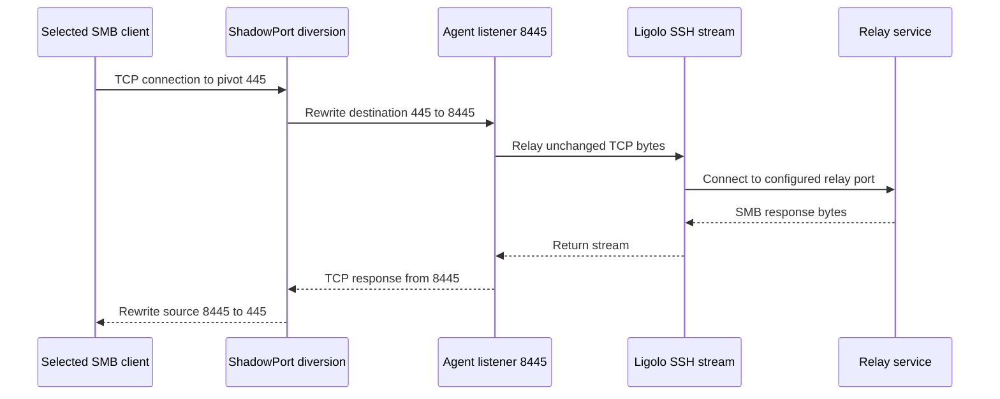
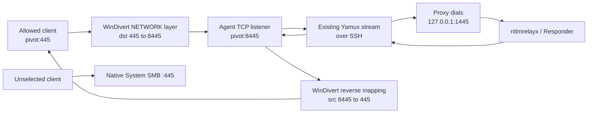

# ShadowPort SMB Relay - Plan

## Goal Capsule

- **Objective:** Let a Windows Ligolo agent receive selected physical SMB callbacks on its already-occupied TCP port 445 and carry the unchanged SMB stream through the SSH transport to Responder or ntlmrelayx on the proxy side.
- **Product authority:** This plan owns Windows AMD64 ShadowPort behavior, operator controls, packaging, lifecycle, and verification.
- **Authority order:** This Product Contract, session-settled Key Decisions, Planning Contract, then implementation-unit detail.
- **Stop conditions:** Stop if the WinDivert 2.2.2 AMD64 DLL or driver fails pinned-hash validation, if the driver fails Authenticode validation, if native port 445 does not return after teardown, or if implementation would require driver modification, manual mapping, EDR bypass, or disabling native SMB.
- **Execution profile:** Deep, high-risk, cross-component code work with Windows kernel-boundary integration and real Windows/WSL verification.
- **Tail ownership:** Implementation owns tests, release packaging, Git publication, and a new GitHub release without deleting the existing release or its assets.

---

## Product Contract

### Summary

Add an opt-in Windows AMD64 ShadowPort listener that uses scoped, symmetric packet translation before TCP socket demultiplexing. Ship it as two additional single-file agents, normal and Garble, without replacing the existing release matrix.
The remote client continues to see SMB on port 445, while the ShadowPort agent accepts the selected flow on an unoccupied internal port and relays it unchanged through the existing Ligolo SSH connection.

### Problem Frame

Windows `System` normally owns TCP port 445, so a Ligolo reverse listener cannot bind that port.
Application-level alternatives such as WebDAV change the callback protocol and depend on the coerced host's WebClient service.
Socket reuse, `netsh interface portproxy`, firewall rules, and a secondary address in the same network compartment cannot deterministically divert an already-owned local port.

### Key Decisions

- **Use symmetric packet translation before socket demultiplexing.** (session-settled: user-approved — chosen over WebDAV callback: preserve SMB and remove the WebClient dependency) Governs R1-R3.
- **Use an embedded, officially signed WinDivert package for version one.** (session-settled: user-directed — chosen over an unsigned custom WFP driver: preserve signature validity and permit real testing) Governs R6-R9, R15-R16.
- **Scope diversion to declared sources and one local address.** Broad interception would disrupt legitimate SMB. Governs R4, R5, R10.
- **Ship ShadowPort on Windows AMD64 first.** Official WinDivert 2.2.2 release assets do not include an ARM64 driver. Governs R13.
- **Ship separate ShadowPort agents and preserve the existing binaries.** (session-settled: user-directed — chosen over replacing the standard agents: make capability and embedded-driver presence explicit) Governs R14-R15, R18.

### Actors

- A1. **Operator:** Starts the elevated Windows agent and explicitly permits ShadowPort capability.
- A2. **Ligolo proxy:** Creates, restores, displays, and removes the ShadowPort listener.
- A3. **Windows agent:** Owns the internal listener, scoped packet translation, flow state, and cleanup.
- A4. **Selected remote client:** Connects to the pivot address on TCP 445 and observes a normal bidirectional SMB connection.
- A5. **Relay service:** Responder or ntlmrelayx receives the unchanged TCP stream on the proxy-side destination port.
- A6. **Native Windows SMB service:** Continues receiving non-selected traffic on the original port 445.

### Requirements

**Traffic behavior**

- R1. A selected inbound TCP flow addressed to the configured Windows agent address and public port 445 must be translated to the configured internal port before Windows chooses the owning socket.
- R2. Every packet in a selected flow must receive symmetric port translation so the remote client sees server port 445 while the local TCP stack sees the internal port.
- R3. The agent must relay the accepted TCP byte stream through the existing Ligolo SSH transport without translating SMB into HTTP, WebDAV, or another application protocol.
- R4. A ShadowPort listener must require one explicit local unicast IPv4 address that exists on the agent and between one and 64 exact remote IPv4 addresses or CIDRs.
- R5. Packets that do not belong to a selected flow must remain on the native Windows path without modification.

**Lifecycle and safety**

- R6. ShadowPort must be disabled by default and require an explicit local agent startup opt-in plus an explicit listener request.
- R7. The internal TCP listener must bind successfully before packet diversion starts.
- R8. Missing elevation, disabled Base Filtering Engine, unavailable driver, invalid driver signature, pinned runtime hash mismatch, blocked driver, invalid scope, or occupied internal port must reject listener creation while leaving native port 445 traffic unchanged.
- R9. Closing the listener, losing the SSH session, terminating the agent, or failing during startup must close the diversion handle and return new connections to the native Windows path.
- R10. Translation state must be bounded and keyed by the complete TCP flow so concurrent clients, retransmissions, FIN, RST, timeouts, and direct traffic to the internal port cannot cross-contaminate one another.
- R11. Operational logs may identify rule lifecycle and connection tuples but must not record SMB payloads, NTLM messages, credentials, or packet dumps by default.

**Operator surfaces and compatibility**

- R12. CLI, API, Web UI, listener listings, deletion, and reconnect restoration must represent the public port, internal port, local address, allowed remote scope, and ShadowPort mode consistently.
- R13. Version one must support Windows AMD64 and return an explicit unsupported-platform error on Windows ARM64, Linux, and macOS while preserving all existing non-ShadowPort behavior on every platform.
- R14. Normal and Garble Windows AMD64 agents must expose identical ShadowPort behavior.

**Packaging**

- R15. Each Windows AMD64 ShadowPort agent artifact must remain a single file for delivery by embedding the untouched signed WinDivert runtime components and extracting them automatically only when ShadowPort is activated.
- R16. Runtime extraction, driver loading, residue, cleanup limits, Administrator requirement, and possible security-product blocking must be documented without describing the feature as dependency-free or unprivileged.
- R17. The release bundle and README beside the binaries must include exact elevated agent, ShadowPort listener, Responder, ntlmrelayx, inspection, and cleanup commands.
- R18. The release must retain the existing proxy, standard agent, and standard Garble agent artifacts for Windows AMD64, Windows ARM64, Linux AMD64, and Linux ARM64, then add `agent-shadow.exe` and `agent-shadow-garble.exe` only under Windows AMD64.

### Key Flows

- F1. Selected SMB callback
  - **Trigger:** A4 opens a new TCP connection from an allowed source to the configured agent address on port 445.
  - **Actors:** A2, A3, A4, A5
  - **Steps:** A3 creates flow state, translates the flow to its internal listener, and uses the existing reverse-listener stream to connect to A5.
  - **Outcome:** A4 and A5 exchange unchanged SMB bytes while observing their configured endpoint ports.
  - **Covered by:** R1-R4, R10
- F2. Unselected native SMB connection
  - **Trigger:** A remote client outside the declared source scope connects to the agent address on port 445.
  - **Actors:** A3, A6
  - **Steps:** The packet does not enter a ShadowPort flow and follows the unmodified Windows path.
  - **Outcome:** A6 receives the connection as it did before ShadowPort activation.
  - **Covered by:** R4, R5
- F3. Listener teardown or transport loss
  - **Trigger:** A1 removes the listener, the SSH session closes, or the agent exits.
  - **Actors:** A1, A2, A3, A6
  - **Steps:** A3 stops admitting ShadowPort flows, closes the diversion handle, releases the internal listener, and clears flow state.
  - **Outcome:** New port 445 connections immediately follow the native Windows path.
  - **Covered by:** R9-R11

### Acceptance Examples

- AE1. **Covers R1-R4, R10.** Given `System` PID 4 is listening on port 445, an allowed WSL client connects to the Windows pivot on port 445; the configured proxy-side relay receives the connection, completes bidirectional TCP exchange, and the client observes server port 445.
- AE2. **Covers R4, R5.** Given an active scoped ShadowPort listener, a client outside the allowed source scope connects to port 445; native Windows SMB receives the connection and the relay receives nothing.
- AE3. **Covers R5, R10.** Given an active ShadowPort listener, a client connects directly to the internal port; that connection remains on the internal port and its responses are not rewritten to source port 445.
- AE4. **Covers R8.** Given an unelevated agent or a blocked driver, listener creation fails with a specific error and a subsequent native SMB connection still reaches `System`.
- AE5. **Covers R9.** Given an established ShadowPort listener, the proxy or agent is forcibly terminated; new port 445 connections return to native SMB without a reboot.
- AE6. **Covers R10.** Given two concurrent allowed clients with independent source ports, each receives only its own relay responses across retransmission and normal FIN or RST closure.
- AE7. **Covers R12, R14.** A CLI-created listener and a Web/API-created listener produce equivalent configuration, survive supported reconnect restoration, and work with both normal and Garble Windows AMD64 agents.
- AE8. **Covers R13.** A ShadowPort request against an unsupported agent returns an explicit unsupported-platform response without affecting a normal reverse listener.
- AE9. **Covers R15-R18.** A clean elevated Windows host receives only `agent-shadow.exe` or `agent-shadow-garble.exe`; activating ShadowPort extracts and loads the signed runtime automatically, and the documented inspection and cleanup commands match observed state.
- AE10. **Covers R18.** A release inventory contains the prior twelve platform artifacts plus the two Windows AMD64 ShadowPort agents, and the previous GitHub release remains available.

### Success Criteria

- Real Windows-to-WSL integration proves selected port 445 traffic reaches a controlled proxy-side SMB/ntlmrelayx listener while PID 4 remains bound to 445.
- Packet evidence proves symmetric port translation, valid IPv4/TCP checksums, no reinjection loop, and no selected packets reaching native SMB.
- Regression tests prove existing SSH modes, keys, no-key mode, standard listeners, Web UI, releases, and Garble builds still work.
- Failure and forced-exit tests prove ShadowPort fails without modifying native traffic and restores the native path when the agent or proxy disappears.

### Scope Boundaries

- Windows AMD64 TCP listeners only in version one.
- No WebDAV, HTTP coercion conversion, SMB protocol parsing, credential inspection, or relay logic inside Ligolo.
- No attempt to share or bind port 445 with `System`.
- No silent elevation, persistence, security-product bypass, custom unsigned driver, or disabling of native Windows SMB.
- Windows ARM64 ShadowPort is deferred until a production-signed ARM64 packet-diversion driver can be built and tested.
- UDP, IPv6 ShadowPort, downstream-router interception, and arbitrary port-map chains are deferred.

### Dependencies and Assumptions

- The Windows agent runs with Administrator rights and Base Filtering Engine is available.
- The selected remote client can reach the pivot address on TCP port 445.
- The operator knows the callback source address or a narrow authorized CIDR before enabling the listener.
- The official signed WinDivert AMD64 driver remains loadable under the test host's Secure Boot, HVCI, and endpoint-security policy.
- The proxy-side Responder or ntlmrelayx version can listen on the configured non-privileged destination port.

### Resolved During Planning

- Use direct dynamic calls through `golang.org/x/sys/windows` instead of a third-party Go binding. This preserves `CGO_ENABLED=0` and limits the trusted dependency surface.
- Accept only an IPv4 local address and IPv4 source addresses or CIDRs in version one. IPv6 traffic never matches the WinDivert filter.
- Create mappings only from an allowed inbound SYN, key them by the complete IPv4 TCP tuple, cap them, expire idle entries, and retain closing entries long enough for FIN exchange.
- Bind the internal listener before opening WinDivert. Close WinDivert before closing the internal listener during orderly teardown.

### Sources and Research

- Existing reverse listener path: `cmd/proxy/app/app.go`, `pkg/controller/agent.go`, `pkg/proxy/listeners.go`, and `pkg/agent/handler.go`.
- WinDivert 2.2 documentation: <https://reqrypt.org/windivert-doc.html>.
- Microsoft WFP packet injection: <https://learn.microsoft.com/en-us/windows-hardware/drivers/network/packet-injection-functions>.
- Microsoft WFP callout drivers: <https://learn.microsoft.com/en-us/windows-hardware/drivers/network/introduction-to-windows-filtering-platform-callout-drivers>.
- Microsoft Winsock address sharing behavior: <https://learn.microsoft.com/en-us/windows/win32/winsock/using-so-reuseaddr-and-so-exclusiveaddruse>.

---

## Planning Contract

### Key Technical Decisions

- KTD1. Add optional, explicitly tagged ShadowPort fields to the existing listener request and listener model. Preserve legacy zero-value behavior and test new-to-old MsgPack decoding. Governs R12-R14.
- KTD2. Build both ShadowPort agents from `cmd/agent` with the `shadowport` build tag. A build-tagged implementation reports capability; the default stub rejects ShadowPort requests. This keeps the standard artifacts free of WinDivert bytes. Governs R6, R13-R15, R18.
- KTD3. Call the WinDivert 2.2.2 DLL dynamically through `golang.org/x/sys/windows`. Use `WinDivertOpen`, `WinDivertRecv`, `WinDivertSend`, `WinDivertHelperCalcChecksums`, and `WinDivertClose`; do not use CGO or modify the driver. Governs R1-R3, R13-R16.
- KTD4. Pin the official release archive and AMD64 DLL/SYS SHA-256 values in a fetch script. Verify the driver's Authenticode signature before staging and call `WinVerifyTrust` on the extracted driver before runtime load; the official DLL is unsigned and is therefore trusted only by its pinned hash. Build and runtime fail closed on mismatch. Governs R8, R15-R16.
- KTD5. Extract `WinDivert.dll` and `WinDivert64.sys` to a fresh directory with an Administrator/SYSTEM/owner-only DACL only when `-allow-shadow-port` is active and the first ShadowPort listener is requested. Reference-count active listeners; unload and remove files after the last listener closes, with residue reported when Windows retains a file. Governs R6, R8-R9, R15-R16.
- KTD6. Capture only non-impostor IPv4 TCP packets matching either the selected inbound public endpoint and source scope or the internal endpoint's outbound traffic. Reinjection uses the original WinDivert address metadata after port rewrite and checksum recalculation. Governs R1-R5.
- KTD7. Admit a flow only on an inbound SYN without ACK. Store public/local and remote tuple data in a synchronized table capped at 4096 entries. Expire half-open flows after 30 seconds, established idle flows after five minutes, and closing flows after 30 seconds, with a five-second sweep. Rewrite outbound packets only when the reverse tuple exists, which leaves direct internal-port traffic unchanged. Reject a new listener when its public endpoint and source ranges overlap an active ShadowPort capture domain. Governs R5, R10.
- KTD8. Treat ShadowPort as listener metadata across controller, CLI, daemon API, Web UI, listing, deletion, and reconnect restoration. Listener deletion must call `Stop` before removing the model. Governs R9, R12.
- KTD9. Publish a new release tag rather than mutating or deleting `v0.9-ssh.1`. The new release contains the full matrix and two clearly named ShadowPort downloads. Governs R17-R18.

### High-Level Technical Design

The packet engine owns only translation and flow state. The existing reverse-listener relay remains the byte-stream transport. ShadowPort never parses SMB or NTLM.

### Implementation Constraints

- Keep `CGO_ENABLED=0` for every artifact.
- Preserve explicit legacy MsgPack field names because Garble changes Go identifiers.
- Do not commit or generate a modified driver. Treat official WinDivert binaries as immutable build inputs.
- Do not expose a broad `any source` default. At least one exact IPv4 address or CIDR is mandatory.
- Do not claim guaranteed diskless loading. The signed driver and DLL touch disk during supported activation.
- Do not add persistence, service-install commands, EDR bypasses, driver-name mutation, or manual kernel mapping.
- Preserve the clean Web submodule history and commit its UI changes in its own repository before updating the parent submodule pointer.

### Sequencing

1. Define protocol and listener-domain metadata with compatibility tests.
2. Implement the smallest packet-rewrite core, then prove one scoped 445-to-internal round trip through an official WinDivert handle on the elevated Windows host.
3. Complete flow-state tests, build-tagged runtime extraction, validation, and lifecycle only after that proof passes.
4. Wire agent, controller, CLI, API, reconnect, and Web UI.
5. Extend release acquisition, builds, documentation, and manifests.
6. Run Windows/WSL integration, regression, cleanup, and release validation.

### System-Wide Impact

- **Protocol:** New optional fields cross every Yamux transport, including SSH, TCP, and WebSocket. Legacy listeners remain the default.
- **Agent lifecycle:** Listener shutdown now owns a kernel handle and extracted runtime files in addition to a socket.
- **Controller/API:** Listener persistence and deletion must preserve or tear down ShadowPort metadata correctly.
- **Web:** The embedded UI and its submodule expose the same validated action as the CLI.
- **Release:** Windows AMD64 gains two large single-file agents. Other platform artifacts and names remain present.
- **Host networking:** Only selected new IPv4 TCP flows to the configured public endpoint leave the native path. A fail-open packet loop is unacceptable.

### Risks and Mitigations

- **Driver blocked by host policy:** Fail listener creation before diversion and surface the Win32 error. Verify native SMB afterward.
- **Packet reinjection loop:** Exclude impostor packets and test packet counts under a sustained transfer.
- **Stale tuple rewrites unrelated traffic:** Use full tuples, SYN admission, bounded idle expiry, and direct-internal-port tests.
- **Abrupt process death leaves files:** OS handle closure restores packet flow; a later run reports and removes version-matched residue when possible.
- **Build supply-chain drift:** Pin archive and file hashes, require valid signatures, record them in the manifest, and include upstream license/source attribution.
- **UI/proxy against an old agent:** Capability display and an explicit unsupported response prevent silent fallback.

---

## Implementation Units

### U1. Extend protocol and listener domain

- **Goal:** Represent ShadowPort configuration and capability without breaking standard listeners.
- **Requirements:** R4, R6, R12-R14.
- **Files:** `pkg/protocol/packets.go`, `pkg/protocol/protocol_test.go`, `pkg/proxy/listeners.go`, `pkg/controller/agent.go`, related tests.
- **Dependencies:** None.
- **Approach:** Add optional configuration and capability fields with explicit MsgPack tags. Introduce listener options that retain public address, internal port, sources, and mode through display and reconnect.
- **Test scenarios:** Standard listener round-trip is unchanged; new packet decodes into a legacy-shaped struct; unsupported or disabled agents return a specific error.
- **Verification:** Focused protocol and listener tests pass under plain Go and Garble builds.

### U2. Implement deterministic packet NAT and flow state

- **Goal:** Make tuple admission, port rewrite, checksum inputs, expiry, and teardown independently testable.
- **Requirements:** R1-R5, R10-R11.
- **Files:** `pkg/agent/shadowport/engine.go`, `pkg/agent/shadowport/packet.go`, `pkg/agent/shadowport/flow.go`, matching `_test.go` files.
- **Dependencies:** U1.
- **Approach:** Separate packet parsing/rewriting and flow tracking from the Windows handle. Accept IPv4 TCP only. Create entries from allowed inbound SYN packets and reverse only mapped outbound tuples. Enforce the fixed capacity and expiry policy from KTD7.
- **Test scenarios:** Concurrent clients, retransmitted SYN, data both ways, direct internal connection, disallowed source, overlapping listener scope, RST, two-sided FIN, half-open/idle/closing expiry, capacity exhaustion, malformed and IPv6 packets.
- **Verification:** Table-driven and race-enabled tests prove byte changes are limited to TCP ports and checksums are marked for recalculation.

### U3. Add signed WinDivert runtime and lifecycle

- **Goal:** Activate the packet engine through official WinDivert only in ShadowPort builds.
- **Requirements:** R6-R9, R13, R15-R16.
- **Files:** `pkg/agent/shadowport/runtime_windows_amd64.go`, `pkg/agent/shadowport/runtime_stub.go`, `pkg/agent/shadowport/assets_shadowport.go`, `scripts/fetch-windivert.ps1`, `third_party/windivert/README.md`, `.gitignore`.
- **Dependencies:** U2.
- **Approach:** First prove a single selected 445-to-internal connection with the official files and minimal rewrite core. Then embed fetched immutable DLL/SYS bytes behind `windows && amd64 && shadowport`. Validate hashes and signatures, extract to a protected fresh directory, load by absolute path, open one scoped handle per listener, reference-count runtime files, and clean up in reverse order.
- **Test scenarios:** Missing elevation, tampered bytes, invalid signature, blocked load, successful open/close, double close, two listener references, forced process termination, and residue cleanup.
- **Verification:** Authenticode and file hashes match official 2.2.2; a live passthrough handle opens and closes without disrupting port 445.

### U4. Wire the Windows agent listener

- **Goal:** Bind the internal socket, start diversion safely, and relay accepted sockets through existing Ligolo streams.
- **Requirements:** R1-R3, R6-R11, R13-R14.
- **Files:** `cmd/agent/main.go`, build-tagged capability files under `pkg/agent`, `pkg/agent/handler.go`, agent tests.
- **Dependencies:** U1-U3.
- **Approach:** Add `-allow-shadow-port`; advertise ShadowPort capability only when the tagged build has that opt-in active. Require it for ShadowPort requests. Bind internal address first, then open diversion. Store a closeable composite listener so listener close and session loss stop diversion before releasing the socket. Protect listener and connection registries with synchronization because multiple Yamux handlers mutate them.
- **Test scenarios:** Start order, failed bind, failed driver open, orderly close, concurrent close, transport loss, normal listener on standard agents, and normal/Garble feature parity.
- **Verification:** Integration logs show internal bind precedes handle activation and native port 445 works immediately after close.

### U5. Add CLI, API, reconnect, and Web parity

- **Goal:** Give every existing operator surface the same ShadowPort action and state.
- **Requirements:** R4, R6, R9, R12-R14.
- **Files:** `cmd/proxy/app/app.go`, `cmd/proxy/app/daemon.go`, `pkg/controller/agent.go`, `pkg/proxy/listeners.go`, `web/ligolo-ng-web/src/pages/listeners/modal.tsx`, `web/ligolo-ng-web/src/pages/listeners/index.tsx`, `web/ligolo-ng-web/src/schemas/listeners.ts`, `web/ligolo-ng-web/src/types/listeners.ts`, tests.
- **Dependencies:** U1, U4.
- **Approach:** Extend `listener_add` with ShadowPort mode, internal port, and source scopes. Add equivalent JSON fields and conditional Web controls. The modal shows ShadowPort only for an enabled-capability agent, requires source scopes, displays the Administrator/driver-extraction warning, preserves entered values after API errors, and reports unsupported or disabled agents without silently creating a standard listener. Preserve metadata during reconnect and make API deletion stop the remote listener before model deletion.
- **Test scenarios:** CLI/API/Web equivalence, invalid or absent source scope, UDP rejection, unsupported agent, list output, delete cleanup, reconnect restore, and old-agent failure.
- **Verification:** API tests, Web build, and live UI/API creation all produce the same listener model and behavior.

### U6. Extend reproducible release packaging

- **Goal:** Produce two new embedded-driver agents while retaining the existing twelve artifacts.
- **Requirements:** R14-R18.
- **Files:** `scripts/build-release.ps1`, optional packaging helper, `artifacts/build-manifest.json`, `artifacts/SHA256SUMS`.
- **Dependencies:** U3-U5.
- **Approach:** Fetch and validate WinDivert once. For Windows AMD64 only, build `agent-shadow.exe` and `agent-shadow-garble.exe` with `-tags shadowport`; keep current commands and names for all existing targets. Record driver version/hashes, artifact kind, Garble seed, and license.
- **Test scenarios:** Clean build, offline rebuild with verified cache, tampered cache rejection, ShadowPort bytes absent from standard agents, expected fourteen-file inventory, and Garble runtime start.
- **Verification:** Manifest and SHA256SUMS enumerate every binary; both ShadowPort agents report capability and standard agents do not.

### U7. Write operator and attribution documentation

- **Goal:** Make the release usable from one README without overstating privilege or disk behavior.
- **Requirements:** R16-R18.
- **Files:** `README.md`, `doc/release-readme.md`, generated `release/README.md`, `LICENSE` or third-party notices.
- **Dependencies:** U5-U6.
- **Approach:** Lead with SSH transport and ShadowPort commands. Include elevated agent start, CLI and Web/API listener creation, key/no-key SSH modes, ntlmrelayx/Responder destinations, verification, normal teardown, forced-exit cleanup, limitations, WinDivert license, and upstream Ligolo kudos.
- **Test scenarios:** Copy every documented command into the actual Windows/WSL setup; confirm names and flags match built help output.
- **Verification:** README commands complete the tested flow and identify all placeholders.

### U8. Run regression, live proof, and publish

- **Goal:** Prove safe behavior on the real Windows/WSL topology and publish without removing prior releases.
- **Requirements:** R1-R18.
- **Files:** `artifacts/TEST-REPORT.md`, release archives/assets, Git metadata.
- **Dependencies:** U1-U7.
- **Approach:** Run unit/race/Web builds, existing SSH key/no-key and listener regression, then selected/unselected 445 tests with PID 4 still listening. Test normal and Garble ShadowPort agents, cleanup, forced exit, and capability rejection. Commit the Web submodule first, update the parent pointer, push, tag a new version, and upload the full matrix plus standalone ShadowPort executables.
- **Test scenarios:** AE1-AE10.
- **Verification:** Test report records commands, timestamps, hashes, observed sockets/processes, packet evidence, cleanup state, commit, tag, and release URLs.

---

## Verification Contract

### Static and Unit Gates

- `go test ./...`
- `go test -race ./pkg/agent/shadowport ./pkg/protocol ./pkg/proxy ./pkg/controller`
- `go vet ./...`
- `npm ci --prefix web/ligolo-ng-web`
- `npm run build-ligolo --prefix web/ligolo-ng-web -- --emptyOutDir`
- Plain and Garble builds succeed with `CGO_ENABLED=0`; standard and ShadowPort agents show the expected capability split.

### Windows Driver and Packet Gates

- Confirm the shell is elevated and `Get-NetTCPConnection -LocalPort 445` reports PID 4 before and after every scenario.
- Verify extracted DLL/SYS hashes and the driver's `Get-AuthenticodeSignature` status before handle activation.
- With a narrow WSL source scope, prove WSL-to-Windows TCP 445 reaches only the proxy-side controlled listener and returns bidirectional bytes.
- With a non-matching source, prove the controlled listener sees nothing and native SMB remains reachable.
- Prove direct connections to the internal port retain that port on replies.
- Stop the listener, kill the proxy, and kill each ShadowPort agent variant; after each action, prove new port 445 connections follow the native path without reboot.
- Inspect packet traces for 445-to-internal and internal-to-445 symmetry, valid TCP checksums, and no reinjection loop.

### SSH and Release Regression Gates

- Repeat SSH transport with private-key authentication and explicit insecure no-auth mode.
- Repeat standard TCP and UDP listeners, TUN traffic, Web UI, and daemon API.
- Run `scripts/build-release.ps1`; verify the full existing matrix plus the two Windows AMD64 ShadowPort agents.
- Compare release hashes to uploaded GitHub assets and download both ShadowPort agents back for a final `-version`/`-help` smoke test.

---

## Definition of Done

- R1-R18 and AE1-AE10 have recorded evidence in `artifacts/TEST-REPORT.md`.
- `agent-shadow.exe` and `agent-shadow-garble.exe` are separate single-file Windows AMD64 artifacts with the official signed WinDivert DLL/SYS embedded.
- Existing Windows/Linux AMD64/ARM64 proxy, agent, and Garble artifacts remain present.
- Selected TCP 445 traffic crosses the Ligolo SSH transport; unselected traffic remains native; direct internal-port traffic is not rewritten.
- Normal teardown and forced process death restore native port 445 routing without reboot.
- CLI, API, Web UI, reconnect restoration, and deletion expose equivalent behavior.
- Plain Go, race, vet, Web, standard release, and Garble gates pass.
- Documentation states Administrator, extraction, cleanup, driver-policy, Windows AMD64, IPv4/TCP, and no-evasion limitations.
- WinDivert and upstream Ligolo attribution and licenses are included.
- Dead-end experiments, temporary traces, extracted runtime files, and abandoned code are removed.
- A new commit and release are pushed; `v0.9-ssh.1` and its assets remain untouched.
